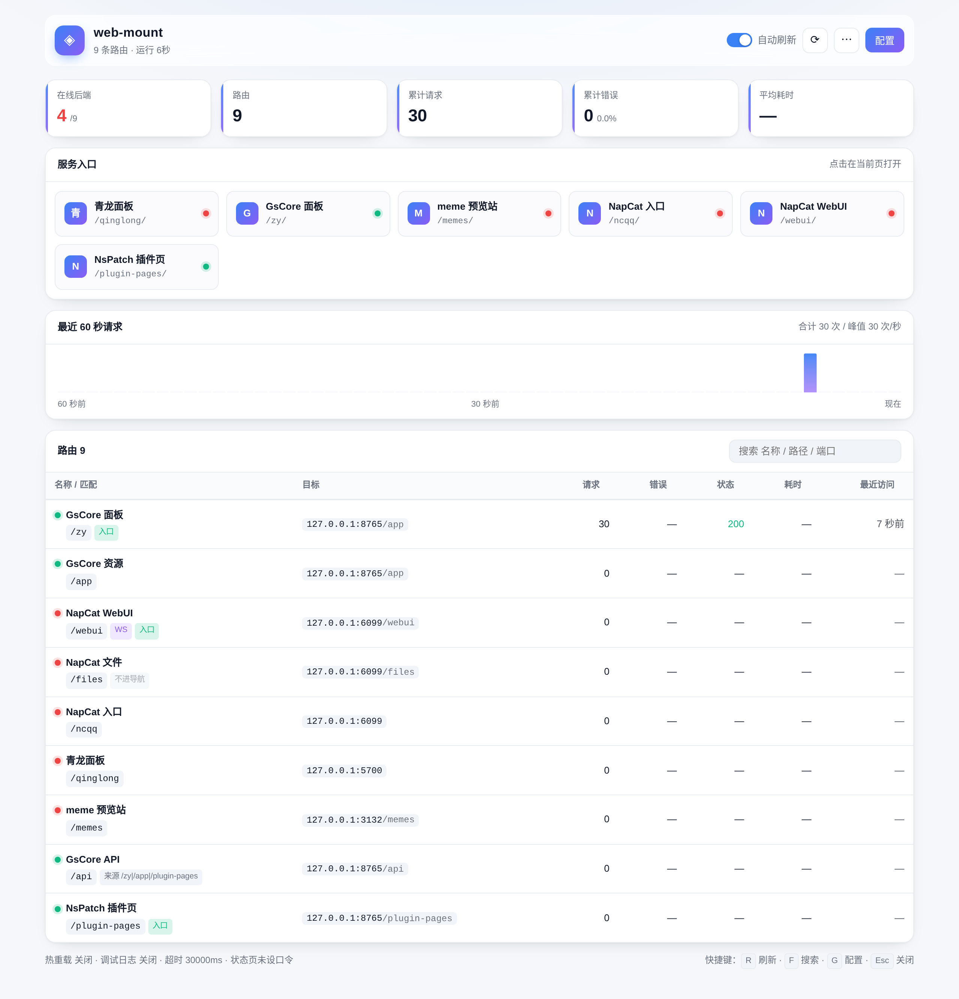
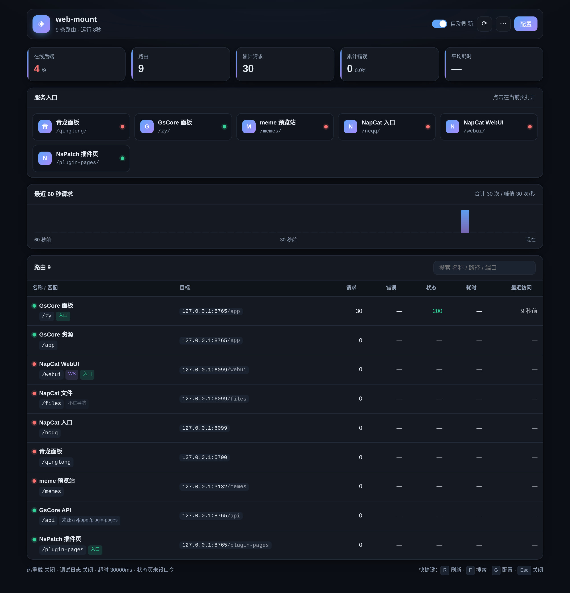

<p align="center"><strong>web-mount</strong> · Yunzai 端口挂载插件</p>

<p align="center">
  <em>把本机各端口服务反向代理到 Yunzai HTTP 端口的任意路径下，锅巴面板可视化配置</em>
</p>

<p align="center">
  <a href="https://github.com/wangdefa1001/web-mount"></a>
  
  
  
</p>

---

## 这是什么

把跑在本机其它端口的面板、静态站、WebSocket 服务，挂到 Yunzai 的 HTTP 端口下：**只记一个端口，用不同路径访问所有服务**。

例如 `127.0.0.1:2536/zy` → GsCore 的 `8765`，`127.0.0.1:2536/qinglong` → 青龙的 `5700`。

---

## 安装

```bash
cd your-yunzai/plugins
git clone https://github.com/wangdefa1001/web-mount web-mount
```

重启 Yunzai。需要 Yunzai 的 `Bot.express` 与 `Bot.server`（即 HTTP 服务已开启）。

**首次启动不会带任何预置路由**——免得把别人的端口、路径抄进你的配置。日志会给出引导：

```
[web-mount] 未找到 config.json，已从 default_config.json 复制模板
[web-mount] 首次运行，配置已生成（还没有任何挂载）。打开 /__web-mount__ 添加第一条路由
```

两种加路由的方式：

- **面板里点**（推荐）：打开 `http://127.0.0.1:<你的HTTP端口>/__web-mount__`，或锅巴侧边栏的「端口挂载」，在配置区填一行即可；
- **手写**：`config/default_config.json` 只有全局设置，`routes` 是空数组。想参考真实写法看 `config/example_routes.json`（纯示例，插件不读它），整段复制进 `config/config.json` 再改端口。

升级：`cd plugins/web-mount && git pull`，然后**重启 Yunzai**（改的是 JS，热重载只监听配置文件）。

---

## 路由字段

一条路由一行，全部字段都在同一张表里：

| 字段 | 说明 |
|---|---|
| `enable` | 是否启用 |
| `name` | 名称，用于日志与入口卡片 |
| `matchPath` | 浏览器访问的路径前缀，如 `/zy`、`/api` |
| `matchReferer` | 来源（Referer/Origin）包含此串才命中，`\|` 分隔多个；留空=不限 |
| `matchMethod` | 限定方法，如 `GET`、`POST\|PUT`；留空=不限 |
| `host` / `port` | 目标主机与端口 |
| `prefix` | 目标内前缀，见下节 |
| `ws` | 是否同时转发 WebSocket |
| `entry` | 是否作为「服务入口」卡片：`true` 显示 / `false` 隐藏 / 留空自动 |
| `autoApi` | 自动生成一条 `/api` 分流，见「自动 /api」 |

**命中规则**：`matchPath` 必须匹配；另两项留空则不限制，填了就要同时满足。
**优先级**：路径越长越优先（`/memes` 先于 `/`），同长度按配置顺序，首条命中即转发。所以 `/api` 的多条分流规则，把更精确的放前面。

> `matchReferer` 只比对 pathname，且默认要求同源（`refererSameOriginOnly`）。Referer 谁都能伪造，不加这条限制，陌生网页就能把你的 `/api` 打到 GsCore/NapCat。

除 `port` 外都可以省。最小的一条路由：

```json
{ "enable": true, "matchPath": "/zy", "port": 8765, "autoApi": true }
```

`host` 默认 `127.0.0.1`、`prefix` 默认 `/`、`name` 省略时自动生成、`matchReferer`/`matchMethod`/`ws`/`entry` 省略即不限。上面这行的意思正好是「GsCore 面板挂在 `/zy`，它的 `/api` 请求也一起分过去」。

---

## `matchPath` 与 `prefix`

公式：**转发路径 = `prefix` + (请求路径去掉 `matchPath` 后的剩余部分)**

| matchPath | prefix | 访问 | 转发到 | 用途 |
|---|---|---|---|---|
| `/memes` | `/memes` | `/memes/a.png` | `/memes/a.png` | 原样透传 |
| `/zy` | `/app` | `/zy/x` | `/app/x` | 换前缀（别名） |
| `/qinglong` | `/` | `/qinglong/login` | `/login` | 剥离前缀到后端根 |
| `/ncqq` | `/` | `/ncqq/abc` | `/abc` | 剥离前缀 |

`prefix: "/"` 是「剥掉挂载前缀」，适合后端本身就跑在根目录的服务（青龙、NapCat、agents 都是）。

---

## 自动 /api

面板类服务（GsCore、NapCat、agents…）的页面挂在 `/zy`、`/webui` 下，但页面里的前端代码是用**绝对路径** `/api/...` 发请求的。这些请求到达 Yunzai 时已经不含挂载前缀，只能靠来源认领。

以前每条页面都要手工再配一条：

```json
{ "matchPath": "/api", "matchReferer": "/zy", "prefix": "/api", "port": 8765 }
```

现在只要在网页那条路由上勾选 **「自动 /api」**（`"autoApi": true`），插件会自己生成这条分流：

```json
{ "enable": true, "name": "GsCore面板", "matchPath": "/zy", "port": 8765, "prefix": "/app", "autoApi": true }
```

启动日志与路由表里会标出来，`config.json` 里不会多出条目：

```
[web-mount] /api(来源 /zy) -> 127.0.0.1:8765/api 已自动生成
```

生成规则（保守为先）：

- 同一后端的多个页面合并成一条，来源是 `/zy|/app` 这种多路径，不重复建；
- 后端**已经有手工 `/api` 路由时不再生成** —— 手工配置优先；
- `matchPath` 为 `/` 的兜底路由不生成（来源无从区分，等于不设防）；
- 派生出来的路由不进「服务入口」，也不会写回配置文件。

---

## 全局设置

| 字段 | 默认 | 说明 |
|---|---|---|
| `autoReload` | `true` | 改配置文件约 2 秒自动生效 |
| `statusPage` | `true` | 开启 `/__web-mount__` 状态页 |
| `statusToken` | 空 | 状态页口令。设了才允许在页面里改配置，公网暴露时务必设置 |
| `debug` | `false` | 每次转发打印方法、URL、状态码、耗时 |
| `proxyTimeout` | `30000` | 转发超时（毫秒） |
| `allowEmbed` | `true` | 允许页面被嵌进面板，转发时剥掉 `X-Frame-Options` 与 CSP 的 `frame-ancestors` |
| `configEditor` | `true` | 是否允许在页面里改配置 |
| `refererSameOriginOnly` | `true` | 来源分流只认同源；关掉等于允许任意站点伪造来源 |
| `trailingSlashRedirect` | `true` | 访问 `/memes` 时 302 到 `/memes/`，让 `./x.js` 这类相对资源解析正确 |
| `quietProxyLog` | `true` | 把已挂载路径从 Yunzai 自带的 HTTP 日志里降级为 debug，避免请求头里的 Token 落盘，见下节 |
| `preserveHost` | `true` | 转发时保留客户端原始 `Host`。关掉会改成后端地址，仅当后端只认自己的 Host 时才关 |

---

## 日志里的 `HTTP GET 请求 { headers: ... }` 是谁打的

**不是 web-mount**，是 Yunzai 框架自带的。trss-yunzai 在 `lib/bot.js` 的 `serverHandle` 里对**每一个**进入 HTTP 端口的请求打一条，并把整份请求头抄出来：

```
[http://host:port/api/version <= ip] HTTP GET 请求 { headers: {
  ... authorization: 'Bearer xxxxx', referer: 'https://host/zy/' ...
} }
```

web-mount 自己的日志一律带 `[web-mount]` 前缀，只在 `debug` 打开时输出，且只打方法、路径、状态码、耗时，**从不打印请求头**：

```
[web-mount] GET /api/version -> 127.0.0.1:8765/api/version 200 5ms
```

真正的麻烦在于：GsCore、NapCat 这类面板的访问令牌就在 `authorization` 头里，框架那条日志会把**明文 Token** 写进日志文件，附带的 `referer` 也把内部路径暴露了。

所以默认 `quietProxyLog: true` —— 启动时把每条路由的 `matchPath`（以及 `/__web-mount__`）push 进 `Bot.express.quiet`。框架对命中的路径把日志级别从 `mark` 降到 `debug`，默认不显示；真要排查时把日志级别开到 debug 依然能看到。

- `matchPath` 为 `/` 的兜底路由**不会**加进去 —— 那等于静音整站日志；
- 热重载换了路径会精确撤销旧条目，也不动别的插件 push 进去的路径；
- 老版本 Yunzai 没有这个数组，直接跳过，不影响运行；
- 想还原原始行为：`"quietProxyLog": false`。

> 如果这些日志已经贴到过群里、issue 或截图里，**去面板后台重置那个 Token**。日志里的是可直接用的凭证。

---

## 状态页与锅巴面板

**状态页**：浏览器打开 `http://127.0.0.1:2536/__web-mount__`。概览卡片、最近 60 秒流量、可搜索排序的路由表、后端在线探测（带延迟）、服务入口卡片，以及一键重载/清空统计。

**锅巴面板**：装了 [guoba-plugin-next](https://gitee.com/longhengmu/guoba-plugin-next) 后，侧边栏「扩展页面」里会多一个「端口挂载」，走锅巴自己的登录鉴权，不用再记状态页地址。

两处是**同一份数据**、**同一套页面**，只有鉴权方式不同。

<p align="center">
  
  
</p>

### 面板怎么用

顶栏只有三个常驻入口：**自动刷新开关 / 刷新 / 配置**，其余收在 `⋯` 菜单里（重载配置、清空统计、退出登录）。低频动作不该和「配置」抢同一个视觉层级。

| 想要 | 怎么做 |
|---|---|
| 改路由或设置 | 点「配置」。抽屉里分了 **路由** / **全局设置** 两个页签，不用在一条长列表里滑 |
| 加一条路由 | 抽屉里「+ 新增路由」，或空表格里的「添加第一条路由」 |
| 只刷新一次 | 顶栏 ⟳，或直接按 <kbd>R</kbd> |
| 找某条路由 | 搜索框，或 <kbd>F</kbd> 聚焦 |
| 打开某个服务 | 点「服务入口」里的卡片，在当前页 iframe 打开；右上角可跳到新标签 |

其它约定：

- **有未保存的改动时**关闭抽屉会先问一句，标题栏也会标出「有未保存的改动」，保存成功后自动关闭抽屉；
- 删除路由、清空统计都用**页内确认条**，不用原生 `confirm()` —— 原生会阻塞整个 JS 线程，自动刷新和 Toast 都会卡住；
- 快捷键：<kbd>R</kbd> 刷新 · <kbd>F</kbd> 搜索 · <kbd>G</kbd> 配置 · <kbd>Esc</kbd> 逐层关闭（确认条 → 菜单 → 查看器 → 抽屉）；
- 表格的**最近访问**显示相对时间（「12 秒前」），悬停看绝对时间；表头吸顶只在表格内部生效，不随页面滚动乱飘。

给脚本用的接口：

```
GET  /__web-mount__?format=json     # 完整状态（需登录，或带 header x-wm-token: <口令>）
POST /__web-mount__/reload          # 重载配置
POST /__web-mount__/reset           # 清空统计
GET  /__web-mount__/logout          # 退出登录
```

口令登录后下发 `wm_auth` Cookie（存的是口令的 SHA-256，`HttpOnly`，7 天），连续错 5 次锁该 IP 60 秒。

> 状态页会暴露本机内部端口。端口映射到公网时，请设 `statusToken`，或把 `statusPage` 关掉在锅巴里看。

---

## 服务入口

把每台后端聚成一张卡片，点一下在页内 iframe 打开。

后端返回 `X-Frame-Options` / CSP `frame-ancestors` 时，转发阶段会剥掉（仅 `allowEmbed` 开启时），所以同源 iframe 能正常显示。

**一个端口上可能挂着多个页面**（GsCore 的 `/zy` 与它插件页 `/daily-analyisis-gscore` 就同在 8765），所以判断「是不是同一个页面」看的是 `prefix`，不是端口：

| `entry` | 行为 |
|---|---|
| `true` | 一定出现，同一后端标几条就出几张 |
| `false` | 一定不出现 |
| 留空 | 自动补一个；已被标「显示」的页面不再重复出卡 |

自动挑选时会跳过 `/api`、`/ws`、`/files`、`/login` 这类接口路径，取 `matchPath` 最短的。

> 同端口想多出一张卡（比如早柚日报），**最省事的做法就是给它标「显示」**，同端口的面板不会因此被挤掉。

---

## 子路径面板（以青龙为例）

umi/react 打包的面板默认按根路径取资源，直接挂到 `/qinglong` 会白屏，控制台报 `MIME type ('text/html')`。要两步：

1. **让面板知道自己的基础路径**：青龙设环境变量 `QlBaseUrl=/qinglong/`（必须前后都有 `/`）；
2. **路由用剥离前缀**：`matchPath=/qinglong` + `prefix=/`。

因为 `QlBaseUrl` 只影响前端，后端的静态资源与接口仍在根目录，必须剥掉前缀才对得上。`prefix` 误填成 `/qinglong`（原样透传）会白屏跳 `/login`。

面板**没有**基础路径配置项时，子路径代理基本无解，改用子域名反代。

---

## 在 Termux / Android 上

插件没有平台相关代码，但手机上这几点容易踩：

| 现象 | 原因与处理 |
|---|---|
| 配置「整个消失」 | 进程被系统回收时可能写坏文件。现在是原子写（临时文件 + rename），坏文件备份为 `config.json.broken` |
| 某个服务转圈很久 | 无请求体的 POST 曾挂在超时，现已立即 `end()` |
| 状态页刷新发热 | 探测已按 `host:port` 去重，不再每条路由建一次连接 |
| 全填 `127.0.0.1` 却连不上 | chroot 容器与宿主 Termux 不是同一网络命名空间。把 `host` 改成宿主机局域网 IP，或让服务监听 `0.0.0.0` |

---

## 常见问题

**面板挂到子路径后白屏 / 跳回 `/login`？**
见上节，两步：设基础路径 + `prefix=/` 剥离。

**`/api` 被多个服务共用会抢吗？**
会。给 `/api` 建多条规则，用 `matchReferer` 区分；或者直接在页面路由上开「自动 /api」，插件会按页面路径生成。

**陌生网页能访问我的后端吗？**
默认不能：来源必须是同源，且只比对 pathname（`?q=/zy` 这种查询串不会误命中）。不要随手关 `refererSameOriginOnly`。

**502 Bad Gateway？**

先分清是哪一层返回的，两者的处理完全不同：

| 日志 | 含义 | 怎么办 |
|---|---|---|
| `[web-mount] 转发失败 xxx -> 127.0.0.1:8765 : ECONNREFUSED` | 我们连不上后端 | 确认端口在监听；后端在容器/别的设备里时 `host` 不能填 `127.0.0.1` |
| `[web-mount] 后端返回 502 xxx -> 127.0.0.1:8765/app/...`（这是后端自己返回的，不是转发失败） | 后端活着，是它自己回的错误 | 去查那个服务自己的日志。常见于它还有下一层上游，上游挂了 |
| 控制台什么都没有 | 502 可能是中间某个环节（frp、nginx）加的 | 绕过代理直连后端，见下 |

插件自己产生的 502，响应体是三行诊断文本（路由名、实际转发路径、错误原因），在浏览器 F12 的 Response 里能直接看到；后端返回的 502，响应体是后端自己的内容。**看响应体一眼就能分清。**

绕过 web-mount 直连后端确认它本身是好的：

```bash
curl -I http://127.0.0.1:8765/app/xxx.woff2
```

`200` 说明后端没问题，问题在转发链路；`404` 是路径不对（常见于面板升级后资源 hash 变了）；连不上就是网络/端口问题。

**配了 `matchPath: "/"` 兜底，Yunzai 自己的页面全被代理走了？**
`/` 会匹配所有路径，包括 Yunzai 自身的。不要轻易用 `/` 兜底。

**忘了状态页口令？**
就存在 `config/config.json` 的 `statusToken` 里，直接看文件，或在锅巴面板重置。

---

## 开发

```
plugins/web-mount/
├── index.js            # 插件入口：注册监听 / 热重载 / 启动日志
├── guoba.support.js    # 锅巴「插件配置」表单
├── guoba/              # 锅巴扩展页面（状态页共用这同一套 html/css/js）
├── lib/
│   ├── route.js        # 路径与匹配（纯函数，可单测）
│   ├── proxy.js        # HTTP / WebSocket 反向代理
│   ├── status-page.js  # 状态页：鉴权 / 登录 / 配置接口 / 渲染
│   ├── config.js       # config.json 的唯一读写入口（归一化 / 迁移 / 原子写）
│   └── status.js       # 运行状态与统计
├── config/             # default_config.json 模板 / example_routes.json 示例 / config.json 本地实配
└── test/               # 自检
```

分工原则：**改转发行为只动 `lib/proxy.js`，改匹配规则只动 `lib/route.js`**，都不需要碰插件生命周期。

```bash
npm install     # 装 eslint + prettier（只在开发时需要，插件运行不依赖）
npm test        # 全部自检：路由 / 兼容 / 原子写 / 端到端 / 并发（用临时目录，不碰你的配置）
npm run lint    # eslint
npm run format  # prettier 格式化
npm run check   # lint + test，提交前跑这个
```

改了 `guoba/` 下的 html/css/js，刷新浏览器即可；改了 `guoba/index.js`（页面描述或接口）在锅巴里点「重新扫描」。

---

## 更新

- **v1.5.11**：转发时保留客户端 `Host`（之前被改写成后端地址，会让面板的 Host 校验/Origin 校验/Set-Cookie Domain 三处同时失配，表现为「页面能开但接口没数据」）；`Set-Cookie` 的 `Domain` 属性改为剥离。
- **v1.5.10**：转发超时的日志区分「连不上后端」与「连上了但后端迟迟不回」—— 两者排查方向相反，但 Node 给的报错文案一模一样。
- **v1.5.9**：转发失败的日志不再只有一句 `err.message` —— 附上人话解释（是端口没监听、还是后端返回响应前就断链）与已发出的请求字节数；后端已返回过响应再断链时，不再把状态码改写成 502；客户端自己关页面不再记 warn。
- **v1.5.8**：状态页整体改版 —— 操作收进「更多」菜单、配置拆页签、页内确认条、快捷键；表头改为表格内吸顶；顶栏/抽屉/Toast 加毛玻璃并处理深色与降级。
- **v1.5.7**：后端自己返回 5xx 时也记日志并计入错误统计 —— 之前只记「转发失败」，后端回的 502 静默透传，排障时无从分辨。
- **v1.5.6**：新增 `quietProxyLog`，把已挂载路径从框架 HTTP 日志里降级，避免请求头里的 Token 落盘；配置模板清空预置路由，示例移到 `example_routes.json`。
- **v1.5.5**：新增「自动 /api」，页面路由勾一下即自动生成 `/api` 分流；锅巴配置表单与配置模块合并为一份字段定义；引入 eslint + prettier 并全量格式化；精简本文档。
- **v1.5.4**：`index.js` 837 行拆成入口 + `route`/`proxy`/`status-page` 三个模块，行为不变。
- **v1.5.3**：修入口丢卡、来源可伪造、迁移丢路径、端口静默丢弃，配置改原子写。
- 更早的改动见 `git log`。

## 许可证

[MIT](LICENSE)

## 致谢

[Yunzai-Bot v3](https://github.com/TimeRainStarSky/Yunzai) · 锅巴面板社区
